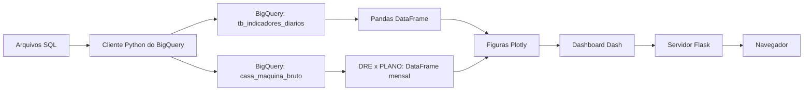

# Visualização — Flask, BigQuery, Pandas e Dash

Atualizado em **15/10/2026**.

Aplicação preparada para GitHub e implantação no EasyPanel por Dockerfile, com porta padrão **8505**. O repositório publica somente `visualizacao/` e os arquivos de documentação e implantação da raiz; o ETL, os dados locais e as credenciais ficam fora do versionamento.

O Flask é a aplicação principal. O dashboard Dash está montado em `/dashboard/`, e o Plotly desenha os gráficos usando dois DataFrames obtidos do BigQuery: indicadores diários e DRE mensal.

## Contexto para próximas sessões

Leia este README para arquitetura, execução, fontes e cálculos. Antes de alterar a apresentação, leia [visual.md](visual.md), o briefing visual e design system do dashboard. Ele documenta a identidade atual, os componentes, a responsividade, as cores das séries e a ordem da primeira página.

Referências do projeto:

| Documento | Conteúdo |
| --- | --- |
| [README.md](README.md) | Operação, arquitetura, regras dos indicadores e situação da implementação |
| [visual.md](visual.md) | Direção visual e padrões de interface para dar continuidade ao trabalho |

O catálogo `PARQUET_DOCUMENTACAO.md`, quando disponível no ambiente de desenvolvimento do ETL, descreve a planilha de origem e não faz parte deste repositório de visualização.

## Estado atual

A **Visão Geral Executiva** é a única página do dashboard. Ela reúne os quatro KPIs, a Curva de Desacoplamento, as seções **Performance de Mídia**, **Mix de Vendas & Produtos** e **Saúde de Clientes & Retenção**, o indicador selecionável, os resultados recentes e a seção financeira final. As páginas adicionais e a navegação por abas foram removidas.

A validação da página única, em **15/10/2026**, passou nos **56 testes**, com dados sintéticos e sem consultar o GCP. A validação anterior dos cálculos e callbacks com dados reais do BigQuery permanece registrada. O papel de parede foi conferido no Chrome headless em 1440, 1280, 768 e 390 px, com dados sintéticos, incluindo seu comportamento durante a rolagem. O Dockerfile e a configuração para o EasyPanel usam a porta **8505**.

A interface usa painéis translúcidos sobre o papel de parede coral. No desktop, os KPIs têm fundo branco a 63%, as seções a 65% e os filtros e a tabela recente a 85%, com desfoque de 3 px. As figuras Plotly têm os dois fundos transparentes. Até 768 px, as superfícies ficam mais opacas e o desfoque passa a zero. Textos, números, sinais e cores das séries mantêm opacidade integral. O [briefing visual](visual.md) registra os valores e a conferência responsiva.

## Fluxo dos dados



1. `data_loader.py` lê os arquivos SQL e consulta indicadores diários e financeiro mensal com `google-cloud-bigquery`.
2. Os resultados são convertidos por `RowIterator.to_dataframe()`: os indicadores têm uma data única por linha e o financeiro tem uma competência mensal única por linha.
3. `app.py` integra Flask e Dash; `layout.py` monta o cabeçalho, os filtros e a Visão Geral Executiva.
4. `callbacks.py` entrega cópias filtradas dos DataFrames a `pages/visao_geral_executiva.py`, que monta suas seções usando os módulos de gráficos e os componentes compartilhados.

As tabelas consultadas são `casa-das-maquinas.casa_maquinas.tb_indicadores_diarios` e `casa-das-maquinas.casa_maquinas.casa_maquina_bruto`. A segunda fornece as células de DRE e PLANO 2026 para o financeiro mensal. A aplicação faz somente consultas de leitura.

## Estrutura

```text
visualizacao/
├── README.md                   # Referência técnica e operacional
├── visual.md                   # Briefing visual e design system
├── __init__.py                 # Exporta a application factory
├── app.py                      # create_app(): Flask + integração Dash
├── config.py                   # Configuração de ambiente e indicadores
├── auth.py                     # Credenciais do Google, apenas no servidor
├── data_loader.py              # SQL -> BigQuery -> Pandas
├── charts.py                   # KPIs e figuras Plotly
├── executive.py                # Calculos dos quatro KPIs executivos
├── planning.py                 # Metas mensais/anuais e rateio por periodo
├── insights.py                 # Calculos de faixas de ticket e registros de clientes
├── insight_charts.py           # Plotly: midia/ROAS, distribuicao, bolhas, rosca e custos
├── insight_sections.py         # Tres secoes Bootstrap da primeira pagina
├── financial.py                # Validacao, filtros mensais e margens da DRE
├── financial_section.py        # Cascata Plotly, resumo e tabela financeira
├── components.py               # Cards, gráficos, tabelas e seções compartilhados
├── layout.py                   # Cabeçalho, filtros e página executiva
├── callbacks.py                # Filtros de período e indicador no DataFrame
├── run.py                      # Execução local no Windows
├── wsgi.py                     # Entrada Gunicorn para Docker/Linux
├── requirements.txt            # Dependências exclusivas da aplicação web
├── .env.example                # Modelo de configuração, sem chave real
├── pages/
│   ├── __init__.py
│   └── visao_geral_executiva.py  # Única página do dashboard
├── sql/
│   ├── indicadores_diarios.sql
│   └── financeiro_mensal.sql    # Cruzamento das celulas de DRE e PLANO 2026
├── assets/
│   ├── dashboard.css
│   └── images/
│       └── Painel de Costura em Tons de Coral.png
└── tests/
    ├── __init__.py
    ├── test_auth.py            # Base64, credenciais completas e formatos anteriores
    ├── test_dashboard.py       # Rotas, filtros, página única e credenciais
    ├── test_executive.py       # KPIs, metas e atalhos de período
    ├── test_decoupling.py      # Dois eixos e agregação temporal
    ├── test_insights.py        # Mídia, ticket e registros de clientes
    └── test_financial.py       # DRE, margens e cruzamento com o plano

Dockerfile                       # Na raiz, para o contexto do repositório
.dockerignore                    # Na raiz, exclui credenciais e arquivos Raw
```

## Executar localmente

Na raiz do projeto, use a `.venv` existente:

```powershell
.\.venv\Scripts\python.exe -m visualizacao.run
```

Abra <http://127.0.0.1:8505/dashboard/>. A raiz `/` redireciona para o dashboard. A rota `/healthz` retorna um JSON com o estado da aplicação, `rows` (linhas de indicadores) e `financial_months` (competências financeiras carregadas, incluindo competências ainda sem receitas observadas).

As dependências necessárias já estão na `.venv`. Para instalar apenas a aplicação web em outro ambiente:

```powershell
python -m pip install -r visualizacao/requirements.txt
```

O marcador de plataforma instala Gunicorn somente no Linux. No Windows, o comando local usa o servidor Flask; o Docker usa Gunicorn como servidor WSGI, conforme a [documentação Flask](https://flask.palletsprojects.com/en/stable/deploying/gunicorn/).

Para conferir a interface com o conjunto observado em 15/10/2026:

| Período | O que permite conferir |
| --- | --- |
| Janeiro de 2025 | Proporção de clientes com os dois tipos informados, custos de referência e DRE |
| Julho de 2026 | Receita, mídia, faixas de ticket e DRE de 2026; clientes exibe a limitação de origem |
| Ano de 2025 | Agregação mensal, lacunas, cobertura parcial de clientes e margens acumuladas |
| Mês atual, outubro de 2026 | Estados vazios, pois a base atual não contém resultados desse mês |

Os atalhos de mês/ano usam o calendário atual em `America/Sao_Paulo`. O cabeçalho informa a data máxima dos indicadores carregados. Reinicie a aplicação após alterar os scripts, as metas ou as fontes no BigQuery.

## Configuração e credenciais

As variáveis do processo têm prioridade sobre o `.env` da raiz. Os valores de exemplo estão em [`.env.example`](.env.example).

| Variável | Padrão / finalidade |
| --- | --- |
| `GCP_PROJECT_ID` | `casa-das-maquinas` |
| `BIGQUERY_DATASET_ID` | `casa_maquinas` |
| `BIGQUERY_TABLE_ID` | `tb_indicadores_diarios` |
| `BIGQUERY_RAW_TABLE_ID` | `casa_maquina_bruto` — origem de DRE e PLANO 2026 |
| `BIGQUERY_LOCATION` | `southamerica-east1` |
| `BIGQUERY_MAXIMUM_BYTES_BILLED` | `104857600` — limite de 100 MiB por consulta |
| `BIGQUERY_QUERY_TIMEOUT` | `120` segundos |
| `GOOGLE_APPLICATION_CREDENTIALS` | Base64 do JSON completo da conta de serviço (recomendado no EasyPanel); também aceita JSON direto, chave PEM ou caminho de um JSON montado no container |
| `GCP_SERVICE_ACCOUNT_EMAIL` | Necessário quando o ambiente fornece somente a chave PEM e não há JSON local |
| `GCP_TOKEN_URI` | `https://oauth2.googleapis.com/token` |
| `GCP_SERVICE_ACCOUNT_FILE` | JSON com os dados da conta; usado como complemento ao PEM no desenvolvimento local |
| `HOST` | `127.0.0.1` para execução local; o Gunicorn faz o bind `0.0.0.0` no Docker |
| `PORT` | `8505` |
| `DASH_URL_BASE_PATHNAME` | `/dashboard/` |
| `TRUST_PROXY` | `false` local; `true` no Docker para o proxy do EasyPanel |

**Configuração local atual:** `GOOGLE_APPLICATION_CREDENTIALS`, no `.env` da raiz, contém o Base64 de um JSON completo da conta de serviço. A conversão preserva a chave PEM ativa e os dados da conta, permitindo copiar uma única linha para o EasyPanel sem depender do JSON local.

**Configuração do container:** copie somente a variável `GOOGLE_APPLICATION_CREDENTIALS` com o Base64 do JSON completo para o ambiente do EasyPanel. O aplicativo decodifica esse valor no servidor e não exige outras variáveis de credenciais. Continuam aceitos JSON direto e PEM junto com `GCP_SERVICE_ACCOUNT_EMAIL` e `GCP_PROJECT_ID`.

O Docker copia somente a pasta `visualizacao`. O `.dockerignore` exclui o `.env`, os JSONs de credenciais, a `.venv` e `Raw`. O `.gitignore` existente também exclui o `.env` e os JSONs. As credenciais ficam no servidor e não são enviadas ao navegador.

## Comportamento do dashboard

O dashboard abre diretamente na **Visão Geral Executiva**, em `/dashboard/`, sem navegação por abas. O módulo `pages/visao_geral_executiva.py` expõe `layout(frame, metric, *, start_date=None, end_date=None, financial_frame=None)` e concentra todas as seções da página.

O contexto financeiro é outro DataFrame, filtrado por competência mensal. As datas representam o período solicitado, mesmo quando não há resultados ou há dias sem registro. Os filtros redesenham a mesma página a partir dos DataFrames em memória, sem novas consultas ao BigQuery.

- Filtros por ano e período aplicados a todas as seções. A seleção inicial é do primeiro dia do mês atual até hoje, no fuso `America/Sao_Paulo`; os atalhos **Mês atual** e **Ano atual** restauram os respectivos acumulados. O filtro manual permite consultar anos e períodos históricos.
- O seletor de indicador controla o gráfico de evolução diária e preserva o ano e o período selecionados.
- Tabelas dos últimos 12 dias com registro no período escolhido.
- Datas sem registro aparecem como lacunas nos gráficos. Valores ausentes são exibidos como `—`.
- O ROAS usa `soma(faturamento_real) / soma(Meta Ads + Google Ads + Outros)`.

### Ordem da primeira página

Depois do cabeçalho, dos filtros e do contador de dias com registro, o conteúdo segue esta sequência:

| Ordem | Seção | Visualização principal | Implementação |
| --- | --- | --- | --- |
| 1 | Resumo executivo | Quatro cards com valores, badges e gráficos compactos | [components.py](components.py), [executive.py](executive.py) |
| 2 | Cruzamento estratégico | Curva de Desacoplamento, com dois eixos Y | [charts.py](charts.py) |
| 3 | Performance de Mídia | Meta, Google e ROAS global em três linhas | [insight_sections.py](insight_sections.py), [insight_charts.py](insight_charts.py) |
| 4 | Mix de Vendas & Produtos | Barras por faixa de ticket diário e bolhas por data | [insight_sections.py](insight_sections.py), [insights.py](insights.py) |
| 5 | Saúde de Clientes & Retenção | Rosca de proporção e barras de investimento por registro | [insight_sections.py](insight_sections.py), [insights.py](insights.py) |
| 6 | Indicador selecionável | Evolução diária do indicador escolhido no filtro | [charts.py](charts.py) |
| 7 | Resultados recentes | Tabela dos últimos 12 dias com registro | [components.py](components.py) |
| 8 | Da receita ao lucro | Resumo, cascata e tabela mensal da DRE × plano | [financial_section.py](financial_section.py), [financial.py](financial.py) |

A seção financeira é a última seção de conteúdo; depois dela vem o rodapé. A composição está em [pages/visao_geral_executiva.py](pages/visao_geral_executiva.py). O [briefing visual](visual.md) detalha a hierarquia e a distribuição de cada bloco.

### Cards da Visão Geral Executiva

Os cards usam `dbc.Card`, grid responsivo Bootstrap (quatro colunas em telas grandes, duas em telas médias e uma em celulares), badges de status e gráficos compactos Plotly. Os cálculos são feitos em Python, em `executive.py`, sobre o DataFrame do BigQuery já filtrado:

| Card | Cálculo |
| --- | --- |
| Faturamento Real vs. Meta | Soma de `faturamento_real`; atingimento = realizado ÷ meta do período |
| ROAS Real Global | Soma de `faturamento_real` ÷ investimento em marketing acumulado |
| Investimento Total em Marketing | Soma de `facebook_ads` + `google_ads` + `outros_investimentos` |
| Ticket Médio Geral (TCM) | Soma de `faturamento_real` ÷ soma de `vendas` |

ROAS e ticket usam as somas do período, sem fazer a média dos índices diários. Os gráficos pequenos mostram a evolução **diária**; o gráfico de atingimento marca a meta em 100%, inclusive quando ela é superada. O status é verde a partir de 100%, amarelo de 90% até menos de 100% e vermelho abaixo de 90%. A cor é acompanhada do percentual e de uma descrição textual.

A página executiva recalcula também `investimento_total` e `roas_real` em uma cópia do DataFrame para manter gráficos, seletor e tabela coerentes com seus cards. Essa definição de investimento segue os três canais solicitados: não soma `meta_api`, que é bruto, nem `investimento_real`, que representa sua conversão. O campo `investimento_total` da origem inclui essa conversão, por isso é recalculado antes da apresentação.

Canais ausentes aparecem como `—` no detalhamento; a soma considera os valores registrados. Se todos os canais estiverem ausentes, o investimento permanece `—`. Divisão por zero e períodos sem dados também aparecem como `—`.

**Planejamento dos cards no script:** a tabela de indicadores diários não contém metas. Preencha `MONTHLY_REVENUE_TARGETS` (chaves `AAAA-MM`) e/ou `ANNUAL_REVENUE_TARGETS` (chaves numéricas `AAAA`), em `planning.py`, com os valores de faturamento aprovados, em reais. Os dicionários começam vazios para não atribuir um valor de planejamento inexistente.

O cálculo prioriza a meta mensal e usa a anual quando não houver meta mensal. A meta é proporcional aos dias selecionados: meta mensal × dias selecionados ÷ dias do mês, ou meta anual × dias selecionados ÷ dias do ano, considerando anos bissextos. Um período que não tenha planejamento em todos os dias exibe **Meta não cadastrada**, sem calcular percentual ou atribuir uma cor de desempenho. Reinicie a aplicação após alterar as metas.

O conjunto conferido em 15/10/2026 contém dados de 2026 apenas em julho. Portanto, o mês atual pode abrir sem resultados; selecionar julho de 2026 ou usar **Ano atual** permite visualizar os registros disponíveis.

### Cruzamento estratégico: Curva de Desacoplamento

A seção central ocupa a largura da página, após os cards, em um card Bootstrap. A figura `revenue_figure`, em `charts.py`, usa `plotly.subplots.make_subplots(specs=[[{"secondary_y": True}]])` com duas séries alinhadas por data:

- **Azul, eixo Y esquerdo:** `faturamento_real`, em reais.
- **Laranja tracejada, eixo Y direito:** `investimento_total`, em reais, com a mesma soma de Meta Ads + Google Ads + Outros usada nos cards executivos.

O eixo X acompanha o filtro: dentro de um único mês, mostra **dias do mês**; em períodos que cruzam meses, mostra **meses/ano**, somando os valores de cada mês. Meses parciais consideram somente os dias selecionados. A agregação mantém os anos separados e não depende de novas consultas ao BigQuery.

Datas e meses sem valores permanecem como lacunas, inclusive no início e no fim do filtro; zero registrado continua sendo zero. Um período inteiramente vazio exibe a mensagem de ausência de dados. Os tooltips mostram valores em reais com formatação brasileira, e os marcadores permitem visualizar pontos isolados. Legenda interativa, zoom e exportação PNG estão disponíveis no Plotly.

As cores dos eixos correspondem às linhas. O texto de apoio explica que cada eixo tem sua própria escala para orientar a comparação da evolução das séries. O gráfico de indicador selecionável continua disponível abaixo da seção.

### Três análises complementares da primeira página

As seções **Performance de Mídia**, **Mix de Vendas & Produtos** e **Saúde de Clientes & Retenção** aparecem na Visão Geral Executiva, após a Curva de Desacoplamento. Seus componentes ficam em `insight_sections.py`, os gráficos em `insight_charts.py` e os cálculos em `insights.py`. Usam o mesmo período filtrado e não geram novas consultas ao BigQuery.

**Mídia:** gráfico de três linhas: Meta em azul e Google em verde no eixo de investimento (reais), com ROAS global em laranja tracejada no eixo direito. A granularidade acompanha a Curva de Desacoplamento: diária dentro do mês, mensal em períodos maiores. O ROAS é recalculado por `soma(faturamento_real) / soma(Meta Ads + Google Ads + Outros)` a cada ponto; não se usa a média dos ROAS diários. A fonte permite observar a evolução conjunta de gasto e retorno global. ROAS por canal requer receita atribuída.

**Mix:** barras horizontais somam as vendas dos dias que se enquadram em cada faixa de **ticket médio diário**. O ticket é recalculado como `faturamento_real / vendas`, considerando vendas positivas e ticket não negativo. As faixas são configuráveis em `TICKET_BAND_EDGES`, em `insights.py`: abaixo de R$ 100; de R$ 100 a menos de R$ 150; de R$ 150 a menos de R$ 300; de R$ 300 a menos de R$ 1.000; R$ 1.000 ou mais. O limite inferior é incluído e o superior excluído. A distribuição é ponderada pelo número de vendas, sem contar dias como vendas. Ao lado, bolhas mostram ticket por data, com tamanho proporcional às vendas. O subtítulo informa a cobertura dos dias analisados.

Como a fonte é diária, cada venda recebe a faixa da média do seu dia. Uma distribuição real dos tickets por pedido e a identificação de máquinas versus peças dependem dos pedidos, SKUs e categorias. Tickets elevados são apresentados como dias a investigar, sem atribuição automática de produto.

**Clientes:** uma rosca compara as somas de novos e recorrentes somente nos dias que informam **ambos** os tipos. A cobertura aparece no subtítulo e no centro da rosca. Valores negativos, fracionários e não finitos não são aceitos como contagens. Recorrentes de maio a setembro são excluídos porque o mapeamento representa CPA. Se o período incluir outros meses válidos, esses dias continuam na análise; a soma diária pode contar a mesma pessoa em datas diferentes.

As barras ao lado mostram **investimento por registro de cliente**, como referência: para cada tipo, soma do investimento de marketing nos dias com investimento e contagem válidos, dividida pela soma dos registros desse tipo **nesses mesmos dias**. Assim, um período sem contagem não entra no numerador. O mesmo investimento total é usado como referência em cada tipo, sem rateio. Cada tooltip informa a cobertura, o investimento e os registros usados. O CAC atribuído por tipo exige custos separados entre aquisição e recorrência; a fonte atual não traz essa atribuição nem identificadores para deduplicar clientes.

Períodos sem dados, contagens zero e divisões inválidas geram estados vazios ou valores ausentes.

### Seção financeira final: DRE × PLANO 2026

**Da receita ao lucro** é a última seção da primeira página, com resumo, gráfico de cascata Plotly (`go.Waterfall`) e tabela mensal Bootstrap. Os dados financeiros vêm do BigQuery, pela consulta `sql/financeiro_mensal.sql`, sem leitura de arquivos locais no runtime ou alterações no GCP.

O SQL cruza as 12 colunas mensais de DRE com os pares previsto/realizado da linha 10 de PLANO 2026. Não inclui totais anuais ou trimestres. O ano é inferido das datas da aba mensal de origem: janeiro a junho e agosto a dezembro pertencem a 2025, enquanto julho pertence a 2026 no conjunto atual. Uma aba que misture competências não recebe um ano automático. Isso evita assumir o ano pelo nome PLANO 2026 ou pelos rótulos anuais inconsistentes da planilha.

| Medida | Fonte / cálculo |
| --- | --- |
| Receita bruta | DRE, linha 4; confrontada com PLANO 2026, linha 10, realizado |
| Receita prevista | PLANO 2026, linha 10, previsto; soma apenas os meses com receitas observadas na análise |
| Impostos sobre vendas | DRE, linha 7 |
| Devoluções | DRE, linha 6; aparecem como outra dedução na cascata |
| CPV | DRE, linha 9 |
| Lucro bruto | Receita bruta − impostos − devoluções − CPV; confrontado com a linha 10 da DRE |
| Margem bruta | Soma do lucro bruto ÷ soma da receita bruta |
| Margem de lucro líquida | Soma do resultado líquido (DRE, linha 24) ÷ soma da receita bruta; corresponde à definição da linha 25 da fonte |

A DRE inclui devoluções de 1% na fonte atual. Excluir essa dedução superestimaria o lucro bruto. A margem bruta e a margem líquida recebem rótulos separados, e as margens acumuladas não são calculadas pela média dos percentuais mensais. A cascata usa valores positivos para receita e negativos para deduções; o lucro bruto usa a medida `total` do Plotly, evitando duplicá-lo.

**Filtros e cobertura:** a DRE é mensal. O filtro de dias seleciona as competências tocadas pelo intervalo; os valores da seção abrangem esses meses completos, sem rateio diário. Um aviso informa essa abrangência quando o filtro é parcial. A tabela mostra quantos dias têm receita registrada. Meses com fórmulas zero e nenhum registro de receita ficam fora do acumulado. Campos de custo ausentes preservam a ausência e impedem um lucro agregado incompleto. Receita zero com registro real mantém seu valor, e a margem fica ausente quando a divisão não é definida.

Diferenças maiores que R$ 0,02 entre receita DRE/realizado do plano ou lucro calculado/lucro da fonte geram um aviso de conciliação. As taxas e custos armazenados na DRE são respeitados, inclusive quando a própria planilha os calcula por fórmula; não são estimados pelo aplicativo.

Na verificação de 15/10/2026, julho de 2026 apresentou receita de R$ 130.337,97, devoluções de R$ 1.303,38, impostos de R$ 0,00, CPV de R$ 54.741,95 e lucro bruto de R$ 74.292,64. A margem bruta foi 57,00% e a margem líquida 28,98%.

Há duas consultas ao iniciar cada processo Flask/Gunicorn: indicadores diários e financeiro mensal. Os filtros operam em cópias dos DataFrames em memória. Recarregar a página reutiliza esses conjuntos; depois de atualizar a Bronze ou a origem financeira, reinicie a aplicação para carregar os novos dados. A transferência usa REST, sem exigir a BigQuery Storage API.

O conjunto original reúne dados de 2025 e 2026. O campo `clientes_recorrentes` ainda usa o mapeamento solicitado para a coluna R, que aparece como CPA nas abas de maio a setembro da planilha de origem. A seção de clientes exclui esses registros das proporções e dos custos de referência. Selecionar esse indicador no gráfico diário exibe o aviso junto ao valor bruto.

A base atual não contém itens de pedido nem identificadores de clientes. As seções de mix de produtos e retenção explicam os campos necessários à integração. As somas diárias de clientes não são tratadas como uma contagem de pessoas únicas; ROAS por canal depende de receita atribuída a cada mídia.

## Testes

```powershell
.\.venv\Scripts\python.exe -m unittest discover -s visualizacao/tests -v
```

Os testes usam dados sintéticos e não consultam o GCP. Cobrem rotas Flask, assets Dash, carregamento direto da página executiva sem abas, filtros de período e indicador por callbacks HTTP, períodos vazios, cálculos ponderados dos KPIs, soma dos canais sem duplicação, metas proporcionais e anos bissextos, limites de cores e superação da meta, atalhos de mês/ano atual, lacunas de datas, alinhamento da Curva de Desacoplamento nos dois eixos, agregação mensal/diária e meses parciais, exclusão de recorrentes com origem em CPA e credenciais PEM de container sem JSON local.

`test_insights.py` também valida os limites das faixas de ticket, ponderação por vendas, ROAS por somas mensais, pareamento de datas dos clientes, custo por registro com numerador e denominador no mesmo conjunto de dias, exclusão de CPA, contagens inválidas e integração das três seções pelos callbacks HTTP da primeira página.

`test_financial.py` valida deduções e devoluções na cascata, margens ponderadas, meses/anos corretos, abrangência mensal de filtros parciais, ausência de custos, zeros sem registros, prejuízo e receita zero, conciliação, navegação HTTP e carregamento de cada fonte uma única vez. `create_app(..., dataframe=..., financial_frame=...)` injeta dados sintéticos; fornecer apenas `dataframe` usa um financeiro vazio, sem consultar o GCP.

`test_auth.py` valida JSON completo em Base64 sem arquivo local ou variáveis adicionais, PEM em Base64 com metadados explícitos, compatibilidade com JSON direto e arquivo montado, campos obrigatórios e rejeição de valores corrompidos sem expor a credencial nos erros.

## Docker e próxima etapa no EasyPanel

O Dockerfile fica na raiz e usa `visualizacao/requirements.txt`, evitando carregar Airflow, Prefect e outros componentes de ETL no processo web.

Quando houver Docker disponível:

```powershell
docker build -t casa-das-maquinas-dashboard .
docker run --rm -p 8505:8505 --env-file .env casa-das-maquinas-dashboard
```

Antes do `docker run`, configure `GOOGLE_APPLICATION_CREDENTIALS` com o Base64 do JSON completo da conta. A variável do `.env` local já está nesse formato e funciona sem copiar arquivos de credenciais para a imagem.

Para a próxima etapa no EasyPanel:

1. Configure o repositório e branch no serviço App.
2. Use a raiz como Build Path e `Dockerfile` como builder/caminho.
3. Configure as variáveis de ambiente e as credenciais no EasyPanel.
4. Defina a porta interna do domínio como `8505`, ou a mesma indicada em `PORT`.
5. Acesse o dashboard em `/dashboard/` e use `/healthz` para a verificação de saúde.

O EasyPanel documenta o [build por Dockerfile](https://easypanel.io/docs/builders) e a [configuração do serviço App](https://easypanel.io/docs/services/app). O processo Gunicorn fica em primeiro plano e escuta em `0.0.0.0` dentro do container.
